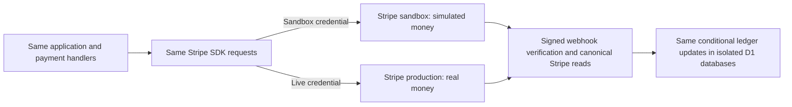

# Staging and production use one payment implementation

SaladFinder runs the same Worker entry point, payment router, Stripe SDK, SQL
migrations and React application in staging and production. Stripe's managed
sandbox simulates financial operations. There is no deployed fake Stripe server,
staging payment engine, synthetic-success switch or shortcut around reconciliation.

## Configuration boundary

| Setting | Staging | Production |
| --- | --- | --- |
| Worker | `daywork-staging` | `daywork` |
| Entry point | `src/server/index.ts` | `src/server/index.ts` |
| `STRIPE_MODE` | `test` | `live` |
| Stripe credential | Restricted key from managed `SaladFinder staging` sandbox | Restricted live key for the account inside `saladfinder` |
| Stripe API and SDK | Same version and endpoints | Same version and endpoints |
| D1 | `daywork-staging` | `daywork-production` |
| Signing secrets and callback URLs | Staging only | Production only |
| `LAUNCH_MODE` currently | `live` enables sandbox workflows | `preview` until operator launch checklist is complete |
| `INSTANT_PAYOUTS_ENABLED` currently | `true` to exercise eligibility checks | `false` while the platform limit is CA$0/day |

The word `live` in `LAUNCH_MODE` is an existing application feature gate; it does
not select Stripe live mode. `STRIPE_MODE` specifies the expected credential mode,
and Stripe's credential determines which provider environment receives requests.
A missing, unknown or mismatched mode fails closed before contacting Stripe.
Both webhook handlers and held-checkout expiry enforce this boundary even when
new payments are disabled. Preview continues to reconcile already-created
operations when credentials are valid.

No payment handler branches on `APP_ENV` or the word `staging`. The same code
performs authorization, input validation, Canadian capability checks, fee and
amount calculation, manual payout setup, durable idempotency, destination
selection, refunds, dispute holds and signed webhook reconciliation. Test and live
webhook payload modes must match the configured provider mode. The shared UI
displays a simulation notice whenever the API reports test payment mode.

Application flags deliberately use the same gates in both deployments. To compare
a particular behavior, use the same gate values and equivalent provider account
capabilities. A disabled production instant option and an eligible sandbox instant
option are different configuration inputs, not different implementations.

Production serves the React build through Sites; staging serves that same build
through its isolated Worker asset binding. Hosting, domains, credentials, account
IDs and database contents differ. This payment design does not claim that staging
duplicates Sites infrastructure or production account restrictions.

## Test and release discipline

1. Build and test a single source revision with `npm run check`,
   `npm run coverage` and `npm run test:e2e`. Run
   `npm run check:deployment-parity` to build both deployment targets without
   uploading and require identical SHA-256 hashes of their Worker executables.
   GitHub CI enforces this comparison.
2. Deploy that revision with `npx wrangler deploy --env staging`. Keep sandbox
   keys encrypted on that Worker. Never copy production users, sessions, bank
   details or database contents into test fixtures.
3. Exercise real application routes using clearly marked synthetic accounts and
   Stripe's documented test identities, cards and payout destinations. Observe
   signed webhook delivery and the resulting ledger; redirects alone are not
   evidence of payment.
4. Promote the same source revision and frontend build to production. Do not
   rewrite payment logic or substitute a provider implementation when promoting.
   Follow [Sites deployment](SITES-DEPLOYMENT.md) for the shared frontend artifact.
5. Keep production in preview until [LAUNCH.md](LAUNCH.md) is satisfied. Sandbox
   acceptance cannot establish bank arrival, live eligibility, limits or fees.

Unit tests can inject a deterministic provider fixture into the same router to
reproduce failures, timing races and reordered events. That fixture exists only in
`tests/`; neither deployed environment imports it. The parameterized payment
lifecycle runs unchanged with test and live provider-object modes and verifies
onboarding, server fees, ownership denial, duplicate Checkout, signed payment
events, both payout methods, duplicate/reordered payout events and full refunds.
Additional tests reject mismatched credentials before provider calls and check
that deployment configuration keeps the shared entry point and isolated storage.
These local tests simulate the provider and do not move live money.

## Provider acceptance checkpoint — 2026-11-05

The managed sandbox and restricted credential are created. Both snapshot webhook
destinations are active, use API version `2026-10-28.endive`, and have distinct
encrypted signing secrets on `daywork-staging`. The deployed staging app created
a Canadian Accounts v2 recipient, set manual payouts and generated hosted
onboarding links. Its status route retrieved recipient capabilities, connected
balance, payout history, external accounts and payout settings using the
restricted key. Synthetic app users completed posting, application, hiring,
starting work, milestone submission and approval through the actual API.

Hosted sandbox onboarding reached its final review with a synthetic identity and
Stripe's test bank. Final onboarding submission, active capabilities, destination
Checkout payment, webhook delivery, refunds and payouts are not yet claimed as
provider-verified. Test records and financial intents are retained in staging for
continuation; they are not production records. No live charge or payout was made.

References: [Stripe sandboxes](https://docs.stripe.com/sandboxes),
[Connect testing](https://docs.stripe.com/connect/testing),
[test cards and simulated settlement](https://docs.stripe.com/testing), and
[webhook verification](https://docs.stripe.com/webhooks).
